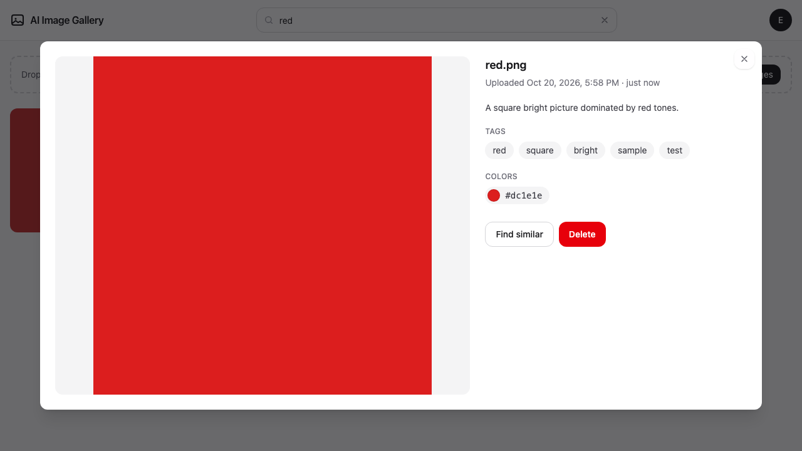
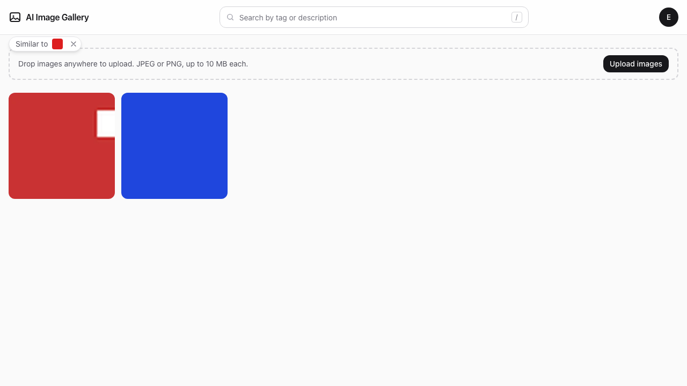
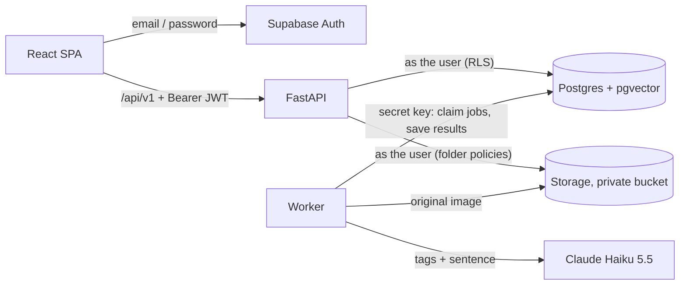

# AI Image Gallery

Upload photos and get back AI-written tags, a one-sentence description and up to three dominant colors. Then search your gallery by words, by similar pictures or by color.

**Live:** https://gallery.hukiewitz.com (sign up with any email address; no confirmation step)


The clip is 20 seconds, recorded with Playwright on the local stack. It uses four pictures drawn for the demo, not photos. The stack runs the fake analyzer, so its tags are placeholders, not model output.

<p align="center">
  
  
</p>

**Status:** all features are merged. The per-user upload quota ([#77](https://github.com/MHHukiewitz/ai-image-gallery/issues/77)) is in progress.

**Start here:** [architecture](docs/architecture.md) · [AI service decision](docs/ai-service-choice.md) · [deployment runbook](docs/deploy.md) · [how the work was split](docs/critical-path.md) · [contributor rules](AGENTS.md)

## Features

Each requirement, and where it's implemented. The end-to-end journey in [`e2e/journey.spec.ts`](e2e/journey.spec.ts) checks most of them in one run, and [`e2e/mobile.spec.ts`](e2e/mobile.spec.ts) checks the phone layout. [e2e/README.md](e2e/README.md) maps every step to its requirement.

- [x] **Sign up, sign in and sign out** with email and password. The gallery needs a session. · [`SignUpPage`](web/src/features/auth/SignUpPage.tsx), [`RequireAuth`](web/src/features/auth/RequireAuth.tsx), [`UserMenu`](web/src/features/auth/UserMenu.tsx)
- [x] **Upload several images at once**, with progress. JPEG or PNG, up to 10 MB each. · [`UploadZone`](web/src/features/upload/UploadZone.tsx), [`uploadQueue`](web/src/features/upload/uploadQueue.ts), [`services/uploads.py`](api/src/gallery/services/uploads.py), [`domain/validation.py`](api/src/gallery/domain/validation.py)
- [x] **Thumbnail grid** of your own images. · [`ImageGrid`](web/src/features/gallery/ImageGrid.tsx), [`GET /api/v1/images`](api/src/gallery/api/routes/images.py)
- [x] **Background AI analysis**: 5 to 10 tags and one sentence per image. A worker claims jobs from a Postgres queue. · [`worker.py`](api/src/gallery/worker.py), [`services/analysis.py`](api/src/gallery/services/analysis.py), [`analyzers/anthropic.py`](api/src/gallery/adapters/analyzers/anthropic.py), [`domain/tags.py`](api/src/gallery/domain/tags.py), queue functions in [`20261020000004_queue.sql`](supabase/migrations/20261020000004_queue.sql)
- [x] **Up to three dominant colors** per image. Computed locally with Pillow, so they cost no AI tokens. · [`domain/colors.py`](api/src/gallery/domain/colors.py)
- [x] **Detail view**: the full picture, description, tags, colors, and delete. · [`ImageModal`](web/src/features/image-detail/ImageModal.tsx), [`DeleteImageDialog`](web/src/features/image-detail/DeleteImageDialog.tsx)
- [x] **Text search** that updates as you type. The query lives in the URL. · [`SearchBar`](web/src/features/search/SearchBar.tsx), [`search_images`](supabase/migrations/20261020000005_search.sql), [`search_images_semantic`](supabase/migrations/20261020000010_semantic_text_search.sql)
- [x] **Find similar**: images that look alike by tags, color and meaning. · [`similar_images`](supabase/migrations/20261020000008_image_embeddings.sql), [architecture §8](docs/architecture.md#8-similarity-embeddings-in-postgres-no-vector-db-service)
- [x] **Filter by color**: click a swatch. · [`images_by_color`](supabase/migrations/20261020000005_search.sql), [architecture §8](docs/architecture.md#8-similarity-embeddings-in-postgres-no-vector-db-service)
- [x] **Each user sees only their own images**, enforced by Postgres row-level security and not by the app. · [`20261020000002_rls.sql`](supabase/migrations/20261020000002_rls.sql), [`rls_test.sql`](supabase/tests/rls_test.sql)
- [x] **Works on a phone**, with no sideways scrolling. · [`mobile.spec.ts`](e2e/mobile.spec.ts), [phone screenshots](docs/screenshots/)

Beyond the brief:

- [x] **Duplicates move to the top** instead of being stored twice. A batch endpoint handles a whole drop. · [`20261020000009_dedupe_and_bump.sql`](supabase/migrations/20261020000009_dedupe_and_bump.sql), [`20261020000011_bump_images_batch.sql`](supabase/migrations/20261020000011_bump_images_batch.sql), [upload routes](api/src/gallery/api/routes/uploads.py)
- [x] **Semantic matching** with a small local embedding model: no API key and no extra service. Vectors live in the same Postgres, in pgvector. · [`adapters/embeddings/fastembed.py`](api/src/gallery/adapters/embeddings/fastembed.py), [`20261020000008_image_embeddings.sql`](supabase/migrations/20261020000008_image_embeddings.sql)
- [x] **Optional tag verifier** (TypeSafe Jev), off by default. · [`adapters/verifiers/jev.py`](api/src/gallery/adapters/verifiers/jev.py), [decision record §3](docs/ai-service-choice.md#optional-second-stage-tag-verification-with-jev-50)
- [ ] **Upload quota**: 300 new images per user in any rolling 24 hours, with exemptions set on the server. In progress as [#77](https://github.com/MHHukiewitz/ai-image-gallery/issues/77).

## Architecture at a glance

The browser signs in with Supabase Auth and calls our API for everything else. The API calls Postgres and Storage **as the signed-in user**, so row-level security decides what each request can see. Uploads are synchronous and return at once. Analysis is asynchronous, in a worker that is the only process holding the Supabase secret key.



The React app, Vite, TypeScript, Tailwind and TanStack Query serve the web side. The API and worker are Python 3.12 with FastAPI, one package and two entrypoints. Pillow computes colors and thumbnails, and fastembed runs the embedding model. Production runs on one VPS behind Traefik, with Supabase Cloud for auth, the database and storage.

The decisions, the data model, the API contract and the search formulas are in [docs/architecture.md](docs/architecture.md).

## AI service choice

**The pick:** Claude Haiku 5.5 at low effort (`AI_MODEL=claude-haiku-5-5`, `AI_EFFORT=low`), called through the official `anthropic` SDK. One call returns the tags and the sentence as validated JSON. The colors are computed locally, so the model never has to guess hex codes.

**The cost:** about **$0.19 per 1,000 images** at low effort, measured on 30 benchmark images. The same model at OpenRouter's default effort measured $0.245 per 1,000, and that is what the live site pays until the Anthropic key arrives ([#28](https://github.com/MHHukiewitz/ai-image-gallery/issues/28)).

Sonnet 5.5 and Opus 5.5 scored the same on our 10-image rating, at 16 to 48 times the cost. Gemini 2.5 Flash-Lite was cheaper but gave generic tags. GPT-6 Luna cost the same and scored lower. The full comparison, including the label APIs and self-hosting, the benchmark method and the risks, is in the decision record, [docs/ai-service-choice.md](docs/ai-service-choice.md).

## Local development

You need [Docker](https://docs.docker.com/get-docker/) (it runs the local Supabase stack), [uv](https://docs.astral.sh/uv/) (it installs Python 3.12 for you), Node 22 or newer, and `make`. The Supabase CLI needs no install: `make` runs a pinned version through `npx`.

```bash
make dev-db                  # starts local Supabase (the first run downloads images) and prints its URL and keys
cp .env.example .env         # paste the printed values into SUPABASE_URL, SUPABASE_PUBLISHABLE_KEY, SUPABASE_SECRET_KEY and the VITE_ lines
(cd api && uv sync)          # Python dependencies
(cd web && npm ci)           # JavaScript dependencies
```

Then run each of these in its own terminal:

```bash
make dev-api                 # API with reload, http://localhost:8000/api/docs
make dev-worker              # analysis worker; ANALYZER=fake needs no AI key
make dev-web                 # web app, http://localhost:5173 (proxies /api to the API)
```

Or run the API, the worker and the web app as containers. The web app is then at http://localhost:8080. This reads the same `.env`:

```bash
docker compose up -d --build
```

`ANALYZER=fake` is the default. It returns deterministic placeholder tags, so every feature works without a key. To use Claude, set `ANALYZER=anthropic` and `ANTHROPIC_API_KEY` in `.env`.

**Mocks mode** replaces the API with in-browser fixtures (MSW), so you can work on the UI without the API or the worker:

```bash
VITE_USE_MOCKS=true make dev-web
```

Sign-in still goes to Supabase, so `make dev-db` has to be running for it. The mocks cover the main gallery flows. They don't cover every endpoint, and the duplicate-bump path isn't mocked, so test repeated uploads against the real stack.

`make help` lists every target.

## Tests

| What | Command | Needs |
|---|---|---|
| Unit tests, API and web | `make test` | nothing |
| Lint, type check and format check | `make lint` | nothing |
| API integration tests against real Postgres and Storage | `cd api && uv run pytest -m integration` | `make dev-db` |
| Database tests: RLS, queue, search, dedupe (pgTAP) | `make db-test` | `make dev-db` |
| End to end: a Playwright journey, and the phone checks | `docker compose up -d --build`, then `cd e2e && npm ci && npx playwright install chromium && npx playwright test` | `make dev-db` and the compose stack |

The end-to-end suite signs up its own users and runs against the real API, worker and Storage, with `ANALYZER=fake`. It deletes those users afterwards.

CI in [`.github/workflows/ci.yml`](.github/workflows/ci.yml) runs each of these as a job. It also checks that the generated API types match the schema, applies the migrations to a clean database, builds the Docker images, and scans the full git history with gitleaks.

## Deployment

Production runs on `gallery.hukiewitz.com`, on a single VPS (ops-server) behind Traefik, which terminates TLS. Three containers (web, api and worker) join the existing `sites` network. Supabase Cloud holds the database, auth and file storage.

[docs/deploy.md](docs/deploy.md) is the runbook. It covers the server `.env`, the Supabase dashboard settings, DNS, `scripts/deploy.sh`, the smoke checks and rollback.

Migrations ship with the code. Supabase's GitHub integration applies each new file in `supabase/migrations/` when its pull request merges to `main`.

## Security notes

**Which key lives where**

| Key or secret | Where it lives | Why that's acceptable |
|---|---|---|
| Supabase URL and publishable key | The browser bundle (`VITE_*`), the API and the worker | Public by design. Anonymous requests can't read any data, because every table's policies apply only to `authenticated`. |
| Supabase secret key | The worker only, in production | It bypasses RLS, so only the one process that needs it has it. The worker has no public ingress. The API never imports it. |
| Anthropic key (or OpenRouter key) | The worker only | It never reaches the browser or the API. Use a spend-limited key. |
| Server `.env` | `/opt/ai-gallery/.env` on the server, mode 600 | Gitignored. The deploy script never copies it. It refuses to deploy while a `CHANGE_ME` placeholder remains. |

Production passes each container only the variables it needs. The local `docker-compose.yml` is looser: its `env_file: .env` gives the local API container the whole file, secret key included. The API doesn't read the key, but it's visible in that container's environment. This is a known gap, listed in the next steps.

**Row-level security, with the user's own token in the API.** The API calls PostgREST and Storage with the caller's JWT, never a service key. RLS is the only authorization layer. Every table's policies are `to authenticated` and check `(select auth.uid()) = user_id`. `image_metadata` has no update policy for users, and the search functions run as `security invoker`. The database tests and the integration tests check that one user can't read, search, find similar to or delete another user's images. The end-to-end journey signs up a second user and checks that it sees none of the first user's data.

**A private bucket.** The `images` bucket is private. Its object policies allow access only under the caller's own folder (`{user_id}/...`). The API hands out signed URLs that expire after an hour (`SIGNED_URL_TTL_SECONDS`).

**Upload hardening.** The API checks the file's bytes (the JPEG or PNG signature), not its extension or its declared type. It caps the size at 10 MB and the image at 40 megapixels. It reads the header before decoding, so an oversized or bomb-like image is refused before its pixels load. It decodes at reduced size, and the display filename is sanitized. Thumbnails and the AI input are re-encoded. The original is stored byte for byte, so its EXIF metadata, including any GPS tag, stays with it. Stripping that is on the next-steps list.

**Email confirmation is off for the demo.** Reviewers can sign up and use the app at once. The cost is that anyone can create an account. The upload quota caps what an account can spend on AI, and the next step is to add SMTP through Resend and turn confirmation back on ([architecture §14](docs/architecture.md#14-decisions-signed-off-2026-10-20)).

**Logs and errors.** Logs are JSON, one object per line. Sentry is off unless a DSN is set. When it's on, it uses the EU region and sends no request bodies, no `Authorization` or `Cookie` headers, no default personal data and no session replays.

## Operating it

On 2026-10-20, production showed four problems. Each has a fix and a test.

1. **Storage refused calls during upload bursts.** Supabase Storage answered `429 too_many_connections` when 20 to 30 images arrived together. Uploads showed errors and blank tiles, and some saved uploads were reported as failed, which invited duplicate re-uploads. Storage calls now retry transient errors with jittered backoff. Signed URLs are cached. A thumbnail that can't be signed no longer fails a saved upload. The uploader sends two files at a time. Empty thumbnails show a placeholder. ([#59](https://github.com/MHHukiewitz/ai-image-gallery/issues/59), [#64](https://github.com/MHHukiewitz/ai-image-gallery/pull/64))
2. **The API ran out of memory on phone photos.** A 12-megapixel JPEG decodes to about 36 MB, and processing copied it several times. The API container hit its 256 MB limit and was killed mid-upload. Now the decoder reads at reduced size, the header is checked without decoding pixels, and concurrent processing is capped. The API limit is 768 MB. In a measured run, one upload's processing peaked at about 10 MB instead of 144 MB. ([#67](https://github.com/MHHukiewitz/ai-image-gallery/issues/67), [#68](https://github.com/MHHukiewitz/ai-image-gallery/pull/68))
3. **Re-uploads stalled.** Two of 26 bump requests waited 15 and 30 seconds on a database read that never answered. Every Supabase call now has an 8-second limit. Idempotent calls retry with jitter, and inserts never retry. Duplicates are bumped in one request per 50 images instead of one per image. The worker wakes as soon as a job finishes and polls at most every 3 seconds, down from 10. ([#76](https://github.com/MHHukiewitz/ai-image-gallery/issues/76))
4. **Phone uploads were cut off with 502s.** Traefik's default 60-second read timeout ended uploads on slow mobile networks. The HTTPS entrypoint on ops-server now allows 300 seconds to read a request. That setting lives in the ops-server repository, not this one.

## Trade-offs and next steps

**Trade-offs we chose**

- **Polling, not realtime.** The grid and the modal poll every 2 to 3 seconds while an image is pending. That's simple and cheap for this demo, at the cost of a few extra requests. Supabase Realtime would remove them.
- **One Postgres for everything.** The queue, the search and the vectors share one database, so there is no Redis or vector service to run. The cost is that they share one connection pool, and the Storage incident came from a small pool.
- **Local embeddings.** Semantic matching runs a 65 MB model in the API and in the worker. Once loaded, the model adds about 165 MiB to the API's memory, which is why the API limit is 768 MB.
- **No model calls in tests or the demo.** Tests and the local stack run the fake analyzer. The production worker and the benchmark script are the only code that calls a model.
- **Email confirmation off**, as described above.

**Next steps**

- Switch production from OpenRouter to the native Anthropic adapter once the key exists ([#28](https://github.com/MHHukiewitz/ai-image-gallery/issues/28)). The native benchmark run follows.
- Turn email confirmation back on, with SMTP through Resend.
- Strip EXIF metadata, or at least GPS tags, from originals.
- Stop passing the whole `.env` to the local API container, and list its variables as production does.
- Replace polling with a realtime channel.
- Replace the per-column job state with a generic jobs table, so other background work can reuse the queue.
- Recalibrate the semantic thresholds if the embedding model changes ([architecture §8](docs/architecture.md#8-similarity-embeddings-in-postgres-no-vector-db-service)).
- Revisit the Jev verifier if a cheaper tagger is adopted ([decision record §3](docs/ai-service-choice.md#optional-second-stage-tag-verification-with-jev-50)).
