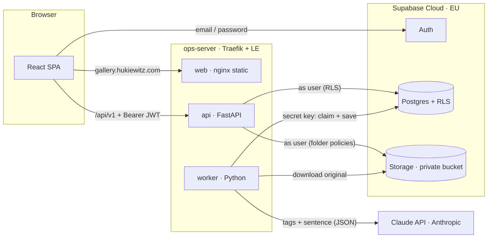
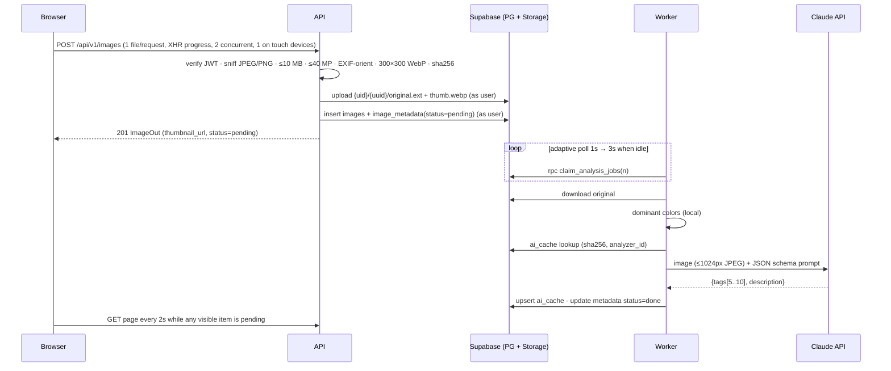

# AI Image Gallery: Architecture

**Status:** Signed off by Mike, 2026-10-20. Changes go through a PR that edits this file.
**Target:** `https://gallery.hukiewitz.com` on the ops-server Hetzner box (5.75.189.90, existing Traefik + Let's Encrypt).

---

## 1. What we optimize for

The grading weights are: core functionality 35%, code quality 25%, UI/UX 20%, AI research 15%. So the design favors:

- **Few moving parts.** No Redis, no vector DB, no self-hosted Supabase.
- **One clear rule per boundary.** Each boundary below has one rule that a reviewer can check.
- **Seams where the challenge invites change.** The AI provider, the search ranking and new job kinds can each change without touching other layers.
- **Many small tickets.** Their file ownership doesn't overlap, so cheap agents can work in parallel without merge fights.

## 2. Key decisions

| # | Decision | Why |
|---|---|---|
| D1 | **Supabase Cloud** (EU/Frankfurt, free tier) for Auth, Postgres and Storage. Local dev uses `supabase start`. | The challenge requires Supabase. Self-hosting it on the 8 GB box means about 10 extra containers and earns no extra points. |
| D2 | The browser uses Supabase **only for Auth**. All data goes through **our API** (`/api/v1`). | There's one typed contract, and the UI never learns table names. The API is also the one place for validation and error mapping. |
| D3 | The API calls Supabase **with the user's JWT** and holds **no secret key**. | RLS stays the single authorization source, even on the server path. A bug in the API can't leak another tenant's data. |
| D4 | **Ingest is synchronous** in the API: validate, thumbnail, store, insert. **AI enrichment is asynchronous** in a worker. | The thumbnail appears instantly and the AI never blocks the upload. |
| D5 | **The queue is `image_metadata.ai_processing_status`**, claimed through an RPC that uses `FOR UPDATE SKIP LOCKED`. | It's durable, needs no Redis, and gives one source of truth for status. |
| D6 | **Dominant colors are computed locally** (Pillow quantize). AI is used only for tags and the sentence. | Local extraction is free and deterministic, and more accurate than hex codes guessed by an LLM. Colors still work when the AI fails. |
| D7 | An **`ImageAnalyzer` port** with three adapters: a **native Anthropic adapter** (the production path), an **OpenAI-compatible adapter** (benchmark comparisons and fallback) and a **`FakeAnalyzer`**. An optional, best-effort **`TagVerifier`** stage (Jev, #50) can then filter and merge tags. A **`TextEmbedder` port** (#63) has a local **fastembed** adapter running `BAAI/bge-small-en-v1.5` and a fake. The worker embeds each analyzed image's description and tags and stores the vector with **pgvector in the same Postgres**, so there is no vector-DB service. | Claude runs on the Max plan's monthly API credits. The official SDK gives typed structured outputs, typed errors and refusal handling. The OpenAI-compatible adapter keeps the comparison honest and keeps another vendor one config change away. Tests and offline dev need no key. The embedding model is small (about 65 MB, ONNX on the CPU, no torch), so semantic matching needs no second API, no key and no extra service, and the API never loads it. |
| D8 | **Search and similarity live in Postgres SQL functions** (`security invoker`). | They run under RLS (so search is automatically per-user), paginate in the DB and need no vector DB. |
| D9 | An **AI result cache** keyed by `(content_sha256, analyzer_id)`. | Re-uploads and re-analysis with the same model cost nothing. Changing the prompt version invalidates the cache. |
| D10 | **React + Vite + TypeScript + Tailwind + TanStack Query**, served as a static SPA by nginx. | This matches the challenge stack and is cheap to host. TanStack Query handles caching, pagination and polling. |
| D11 | **Same-origin deploy:** Traefik routes `gallery.hukiewitz.com` to web and `…/api` to FastAPI. | No CORS, and the existing ACME and `security-headers@file` middleware are reused. |
| D12 | **Observability is structured JSON logs plus Sentry** (errors only, EU region, no replay, scrubbed). Sentry sends nothing without a DSN. **No Dagster, MLOps platform or product analytics.** | Per-image jobs don't fit a batch orchestrator, and the DB queue already handles retries. Sentry catches what logs miss. Replay would record users' private photos, and PostHog would add GDPR consent work without earning points. |

## 3. System view



**Trust boundaries**

| Component | Holds | Can touch |
|---|---|---|
| Browser | Supabase URL and **publishable** key (public by design) | Auth only. Everything else goes through the API. |
| API | Publishable key and the JWKS URL | Only the requesting user's rows and objects, enforced by RLS |
| Worker | **Secret key** and **AI key** | All tenants' rows and objects, but only through the queue RPCs and by job `user_id`. It has no ingress. |

## 4. Flows

### Upload and analysis



**Failure handling**

- If the DB insert fails after the objects were uploaded, the API deletes the objects.
- The adapter retries transient errors itself (429, 5xx, timeouts): 2 retries with exponential backoff. Invalid JSON gets one repair attempt.
- Every Supabase database request has an 8-second limit (`SUPABASE_HTTP_TIMEOUT_SECONDS`). Idempotent calls (reads, lookups, the bump and reanalyze RPCs) retry up to 3 times with full-jitter backoff on timeouts, connection errors, 429 and 5xx. Inserts are never retried. Storage calls retry up to 4 times on 429, 5xx and network errors, so an upload burst doesn't turn into false failures.
- At the job level, `attempts < 3` sends the job back to `pending` with `next_attempt_at`. After that it becomes `failed`, with `last_error` set and the colors kept.
- A crashed worker leaves jobs in `processing`. After 5 minutes, `claim_analysis_jobs` reclaims them.
- The UI shows "Analysis failed · Retry". Retry calls `POST /images/{id}/reanalyze`, which calls the `request_reanalysis` RPC.

### Duplicates and bumps

A file the user already has is never stored twice. The API hashes the upload (`content_sha256`) and looks the hash up among the caller's own images **before** any Storage write. On a match, `bump_image` moves that image to the top of the gallery and the API answers `200` with the existing image. Otherwise it stores the file as usual and answers `201`. Two identical uploads that race can both get through, and the web client's batching covers the usual case.

For a whole drop, the web client hashes the files, asks for the matches with `POST /api/v1/images/lookup` in batches of 50, and bumps the duplicates with `POST /api/v1/images/bump`, also in batches of 50. A batch bump is one RPC and one signed-URL call. The ids are stamped in array order, so the last one ends up on top. Ids that aren't the caller's are left out of the response. A bump changes only the sort time (`last_uploaded_at`), so images stay immutable for users.

### Search

The URL state drives one grid:

- `/` lists all images.
- `/?q=beach` runs a text search.
- `/?similar_to=42` finds similar images.
- `/?color=%23aabbcc` filters by color.
- `&image=42` opens the modal, so the back button closes it.

Each of these maps to the single list endpoint `GET /api/v1/images` with one of the filters. The service dispatches to an SQL function, and the result comes back as `Page[ImageOut]`. The grid never knows which mode it's in.

## 5. Data model

The challenge's table and column names are kept. Columns are only added.

```sql
images(
  id bigint generated always as identity primary key,
  user_id uuid not null references auth.users on delete cascade,
  filename varchar(255) not null,            -- display only, sanitized
  original_path text not null,               -- {user_id}/{uuid}/original.jpg|png
  thumbnail_path text not null,              -- {user_id}/{uuid}/thumb.webp
  mime_type text not null, size_bytes int not null,
  width int not null, height int not null,
  content_sha256 char(64) not null,
  uploaded_at timestamptz not null default now(),
  last_uploaded_at timestamptz not null default now()  -- the sort key; a bump moves it to now
)
image_metadata(
  id bigint generated always as identity primary key,
  image_id bigint not null unique references images on delete cascade,
  user_id uuid not null references auth.users on delete cascade,
  description text, tags text[] not null default '{}', colors varchar(7)[] not null default '{}',
  ai_processing_status varchar(20) not null default 'pending'
    check (ai_processing_status in ('pending','processing','done','failed')),
  attempts int not null default 0, next_attempt_at timestamptz, claimed_at timestamptz,
  last_error text, analyzer_id text,
  search_vector tsvector,                    -- trigger-maintained: tags (weight A) + description (B)
  colors_lab float8[],                       -- trigger-maintained from colors (CIE Lab, 3×3 flattened)
  created_at timestamptz not null default now(), updated_at timestamptz not null default now()
)
ai_cache(content_sha256 char(64), analyzer_id text, result jsonb not null,
         created_at timestamptz default now(), primary key (content_sha256, analyzer_id))
```

**Indexes**

- `images(user_id, uploaded_at desc, id desc)`
- GIN on `search_vector`
- GIN on `tags`
- Partial index on `image_metadata(next_attempt_at) where status = 'pending'`

**RLS policies.** All tables have RLS enabled. Policies are per command and `to authenticated`, using `(select auth.uid()) = user_id` with matching `with check`:

| Table | Policy |
|---|---|
| `images` | `select`, `insert`, `delete` for the owner |
| `image_metadata` | `select` for the owner. `insert` only with `status = 'pending'` and only for an owned image. **No `update` for users.** The worker updates through the secret key, and users go through `request_reanalysis(image_id)`, which is `security definer` and checks ownership. |
| `ai_cache` | RLS on, with **no policies**, so only the secret key can access it |

**Storage.** A private bucket named `images`. The `select`, `insert` and `delete` policies on `storage.objects` require `(storage.foldername(name))[1] = (select auth.uid())::text`.

**Queue RPCs.** These are `security definer` and `grant execute` to `service_role` only:

- `claim_analysis_jobs(n)`
- `complete_analysis_job(...)`
- `fail_analysis_job(...)`

**Search RPCs.** These are `security invoker`:

- `search_images(q, lim, off)`
- `search_images_semantic(q, q_embedding, lim, off)`
- `similar_images(image_id, lim, off)`
- `images_by_color(hex, lim, off)`

## 6. API contract (v1)

All endpoints except health require `Authorization: Bearer <supabase access token>`. Errors use one shape: `{"error": {"code": "...", "message": "..."}}`.

| Method | Path | Notes |
|---|---|---|
| GET | `/api/health` | Liveness check. With `?deep=1` it also checks the DB. Used by Uptime Kuma. |
| POST | `/api/v1/images` | Multipart `file`. Returns 201 `ImageOut`. Returns 200 with the existing image when the caller already has the same bytes, which are bumped to the top. 413 if too large, 415 if not JPEG/PNG. |
| GET | `/api/v1/images` | `offset` (default 0) and `limit` (20, max 50). **At most one** of `q`, `similar_to` or `color` (`#rrggbb`); otherwise 422. Returns `Page[ImageOut]`. |
| GET | `/api/v1/images/{id}` | Returns `ImageOut` plus `original_url` |
| DELETE | `/api/v1/images/{id}` | Returns 204. Removes the objects and the rows. |
| POST | `/api/v1/images/{id}/reanalyze` | Returns 202. Resets the status to `pending`. |
| POST | `/api/v1/images/{id}/bump` | Moves one of the caller's images to the top. Returns 200 `ImageOut`, or 404. |
| POST | `/api/v1/images/bump` | Body `{"image_ids": [...]}`, 1 to 50 ids. Returns `{"items": [ImageOut]}`, with one signed-URL call. Ids that aren't the caller's are left out. |
| POST | `/api/v1/images/lookup` | Body `{"content_sha256": [...]}`, 1 to 50 hashes. Returns the caller's matches as `{"matches": {sha: id}}`. |

```ts
type AnalysisStatus = "pending" | "processing" | "done" | "failed";
interface ImageOut {
  id: number; filename: string; uploaded_at: string; width: number; height: number;
  thumbnail_url: string;            // signed, 1h
  original_url?: string;            // detail endpoint only
  analysis: { status: AnalysisStatus; tags: string[]; description: string | null;
              colors: string[]; error: string | null };
  score?: number;                   // search modes only
}
interface Page<T> { items: T[]; next_offset: number | null }
```

Pydantic models in `api/src/gallery/api/schemas.py` are the source of truth. The TypeScript types are generated from OpenAPI with `openapi-typescript`, so neither side hand-writes them.

## 7. AI analysis

**Prompt.** The model gets a system prompt and a strict JSON schema:

```json
{ "tags": ["5–10 items, lowercase, 1–2 words"], "description": "one sentence, ≤ 25 words" }
```

The prompt is versioned (`PROMPT_VERSION`), and `analyzer_id = f"{provider}:{model}:{PROMPT_VERSION}"`.

**Normalization.** Tags are trimmed, lowercased and deduplicated, then clamped to 10. If fewer than 5 come back, the adapter retries once.

**Usage.** Each analysis returns `usage`: provider latency, input and output tokens, and the provider-reported cost. The worker logs it once per job, which makes the worker log our cost dashboard. The benchmark (#6) reads the same field.

**Cost control.** The image is downscaled to a 1024 px long side as JPEG q85 before sending. This uses Everlast's `normalize_image` pattern. Colors never cost tokens.

**Provider choice.** We use **Claude through the Anthropic API**. The full comparison and rationale are in the decision record, **[ai-service-choice.md](ai-service-choice.md)**. It's paid from the Max plan's monthly API credits, so this demo's volume costs nothing extra. **Mike picks the model** from #6's measured benchmark, which is the deliverable for the 15% research item.

The benchmark runs 20 fixture images through these candidates:
- **Claude:** `claude-haiku-5-5`, `claude-sonnet-5-5` and `claude-opus-5-5`, directly through the native adapter (#31);
- **Non-Claude reference:** at least one model through OpenRouter.

It records cost per 1k images, p50/p95 latency, JSON validity rate and a 1–5 quality score. The doc compares those results against classic vision APIs and self-hosting:

- **Vision LLMs (one call returns tags and a sentence):** Gemini Flash/Flash-Lite class, OpenAI mini/nano class, Claude Haiku class.
- **Classic vision APIs:** Google Cloud Vision and AWS Rekognition. They return labels and colors but no sentence, so a second service would be needed.
- **Self-hosted:** Ollama with a Qwen-VL class model on the VPS. It's free and private, but too slow on CPU.
- **Typed decision model:** TypeSafe Jev 1.14, which has experimental image input. It only returns typed answers (Choice, Score, Boolean, Box), so it can't write the sentence and can only tag from a fixed vocabulary. It's listed in the comparison but not benchmarked. Our pipeline could later use it as a cheap verifier for tags or moderation.

**Rough cost per image**, about 1.4K input tokens with a few hundred output tokens at low effort:
- Haiku 5.5: well under $0.001
- Sonnet 5.5: under $0.01
- Opus 5.5: about $0.01

All three fit easily within $200 a month for a demo. #6 replaces these estimates with measured numbers.

**Tag verification (optional, #50).** With `TAG_VERIFIER=jev`, a TypeSafe Jev call checks each tag against the image and merges near-duplicates. The selection rule always keeps 5–10 tags, and any verifier failure keeps the original tags. See the decision record for the spike numbers.

**Colors.** The worker downsamples to 128 px and runs `Image.quantize(colors=8, method=MEDIANCUT)`. It ranks the palette by pixel count and drops near-duplicates (ΔE < 10). Then it returns the top 3 as `#rrggbb`.

## 8. Similarity (embeddings in Postgres, no vector DB service)

- **Semantic similarity:** The worker embeds each analyzed image's text, `"{description} Tags: {tag}, {tag}, …"` built from the *final* tags after the verifier, with **BAAI/bge-small-en-v1.5** (MIT, 384 dimensions) through **fastembed**. It runs on the CPU as an ONNX model with no torch. The worker loads the model, and so does the API, but only when a user first runs a text search (see Text search below). Both load it from `/opt/models`, where the Docker image put it at build time, so the runtime never downloads it. The vector goes into `image_metadata.embedding` (pgvector, `vector(384)`) and the model's id into `embedding_model`. The vectors live in the same Postgres as the rows they describe, are compared under RLS, and need no index at this scale, so there is no vector database. `dog` now finds `puppy` and `beach` finds `sea`. Embedding is best-effort: a failure logs a warning and the job still ends `done`.
  `semantic(A, B) = max(0, (cos(A, B) − floor) / (1 − floor))`, where `cos` is the cosine similarity of the two embeddings and **`floor` is 0.65**.
- **Why a floor:** bge-small compresses its scores into a narrow band, and unrelated texts still score 0.5 to 0.7. Using the raw cosine as a 0..1 score would make every image look 60% similar to every other one. The floor was calibrated against the real model, on word pairs and on description-plus-tags texts for the 11 bench images and 12 ordinary photos (253 pairs, labelled by shared topics):

  | Pair | Raw cosine | `semantic` |
  |---|---|---|
  | `dog` / `puppy` | 0.867 | 0.62 |
  | `beach` / `sea` | 0.837 | 0.53 |
  | `house` / `red house` | 0.736 | 0.24 |
  | `dog` / `car` | 0.670 | 0.06 |
  | `beach` / `snow` | 0.646 | 0 |

  | Image pairs, by shared topics | n | Raw cosine: median (p10–p90) | Median `semantic` at 0.65 |
  |---|---|---|---|
  | Related (two or more topics) | 9 | 0.85 (0.76–0.91) | 0.57 |
  | Partly alike (one topic) | 30 | 0.75 (0.65–0.82) | 0.27 |
  | Different | 214 | 0.60 (0.53–0.70) | 0 |

  At 0.65, 78% of the different pairs map to exactly 0 (their mean is 0.03 and their 90th percentile 0.15), while related pairs score 0.12 to 0.80. A floor of 0.70 zeroed a related pair of puppy photos (raw 0.69), and 0.60 left the different pairs at a mean of 0.08. The floor is the SQL constant `search_embedding_floor()`, and an integration test with the real model keeps it honest. Changing `EMBEDDING_MODEL` means calibrating again and re-running the backfill.
- **Tag similarity (fallback):** `tag_sim(A, B) = |A ∩ B| / sqrt(|A| · |B|)`. This is cosine similarity on binary vectors, where A and B are the *word sets* of the two images' tags, not the tag strings. A trigger splits every tag into words, stems them with the `english` text search configuration (stop words drop out) and deduplicates them into `image_metadata.tag_lexemes`. So `house`, `houses` and `red house` overlap, where whole-string matching would score them 0. This is for matching only: `tags` stays exactly as the model wrote it, so compounds such as `hot dog`, `palm tree` and `New York` show intact in the UI and still get the exact-tag boost in text search. It replaces `semantic` whenever either image has no embedding yet (an upload not embedded yet, an image analyzed before embeddings, or `EMBEDDER=none`) or the two embeddings come from different models, which can't be compared. A re-analysis that changes an image's tags or description drops its embedding until the worker stores a new one, so a vector never outlives the text it came from. `python -m gallery.backfill_embeddings` embeds the images analyzed earlier.
- **Color similarity:** `color_sim(Ct, Cc) = mean over c in Ct of max over d in Cc of (1 − min(ΔE76(c, d), 100) / 100)`. It's computed in CIE Lab, because RGB distance doesn't match how people perceive color. The doc will explain this.
- **"Find similar":** `score = 0.7 · semantic + 0.3 · color_sim`, with `tag_sim` standing in for `semantic` as described above. It excludes the target and keeps `score > 0.1`, sorted descending.
- **"Filter by color":** `dist = min over d in Cc of ΔE76(query, d)`. It keeps `dist ≤ 25`, sorted ascending.
- **Text search:** there are two functions, and the API picks one per request.
  - `search_images` matches words. `search_vector @@ query`, where the query is built from the input tokens with `:*` prefix matching on each token, so results update as you type. Results are ranked by `ts_rank_cd` plus a boost for an exact tag match. The API calls it when it has no embedding of the query: `EMBEDDER=none`, or the embedding failed (a `warning` in the log, and the search goes on by words).
  - `search_images_semantic(q, q_embedding, lim, off)` matches words **and** meaning, so `puppy` finds dog photos and `seaside` finds beaches. An image is a candidate when every word of `q` matches it (as above) **or** `semantic(query, image) ≥ SEMANTIC_MIN`, with `semantic` as defined above. `score = W_TEXT · rank / (rank + 1) + W_SEM · semantic + EXACT_TAG_BOOST`, where `rank` is `ts_rank_cd` (0 without a word match) and the boost is 0.5 when the whole query equals one of the image's tags. It orders ties by newest upload, then id, so pages are stable. Images with no embedding yet still match on words. It is a separate function, because PostgREST can't choose between two overloads that share argument names.
  - **The query's embedding.** The API embeds `"Tags: {query}"`, the query written as the only tag of an image, which is the format of the stored texts and the one the constants below were calibrated on. It uses `build_embedder`, the same model as the worker. The model loads in a thread on the first text search in the API process (about 0.2 s, and the first request takes about 0.4 s end to end) and stays loaded, so a process that never searches text never imports it. A search that takes more than 10 s to embed gives up and searches by words. The model adds about 165 MiB to the API process, which measured 75 MiB right after startup, 241 MiB after the first text search and 262 MiB after 50 more, 8 at a time, inside the production image with the production 768 MiB limit. `EMBEDDING_MODEL` must be the same in the API and the worker, because the function can't tell whose vectors it compares.
  - **Calibration.** Run on the real model with 92 photos: the 11 bench images (texts labelled as in #63) and 81 ordinary photos with texts written in the analyzer's style (dogs, beaches, churches, food, night scenes, cars, writing, flowers, and a camera roll's distractors). None comes from production. For each of the 8 queries `puppy`, `seaside`, `church`, `food`, `night`, `red car`, `writing` and `flowers`, every photo is labelled relevant (43 pairs), borderline (33) or irrelevant (660). A bare one-word query scores lower against a photo's text (median 0.695 for relevant photos) than two related photos score against each other (0.85), so the 0.65 floor, set on photo pairs, would zero 19% of the relevant pairs if the query were embedded bare. Writing the query as a tag, in the format of the stored texts, lifts the relevant pairs above the floor with room to rank by, and separates as well: both formats find 81% of the relevant pairs at a 1% false-positive rate.

    | Query to photo cosine | n | median (p10–p90) |
    |---|---|---|
    | Relevant, query embedded as `Tags: {query}` | 43 | 0.742 (0.710–0.811) |
    | Borderline | 33 | 0.680 (0.636–0.736) |
    | Irrelevant | 660 | 0.619 (0.558–0.676), highest 0.751 |
    | Relevant, query embedded bare | 43 | 0.695 (0.637–0.749) |
    | Irrelevant, query embedded bare | 660 | 0.537 (0.485–0.601), highest 0.690 |

    Choosing `SEMANTIC_MIN`, with the query embedded as `Tags: {query}` and the images found by meaning alone:

    | `SEMANTIC_MIN` | Cosine needed | Relevant found | Irrelevant shown | Nonsense queries with results (of 5) |
    |---|---|---|---|---|
    | 0.10 | 0.685 | 41 of 43 | 49 (7.4%) | 3 |
    | 0.15 | 0.703 | 39 | 16 (2.4%) | 0 |
    | **0.20** | **0.720** | **35** | **7 (1.1%)** | **0** |
    | 0.25 | 0.738 | 25 | 2 (0.3%) | 0 |
    | 0.30 | 0.755 | 19 | 0 | 0 |

    The nonsense queries are `xylophone`, `quantum physics`, `spaceship`, `asdfgh` and `tax return`; the highest cosine any of them reached was 0.697. 0.20 is the first value that leaves a margin above that. With the real function (words and meaning), the same 8 queries find 37 of the 43 relevant photos where words alone find 19, and show 8 irrelevant ones (one of them a word match: `car` is a prefix of `carrying`). Per query, relevant photos found by words, by meaning only, and missed: `puppy` 2 / 3 / 1, `seaside` 1 / 4 / 0, `church` 4 / 0 / 0, `food` 1 / 7 / 1, `night` 6 / 0 / 0, `red car` 2 / 0 / 0, `writing` 0 / 1 / 4 (`writing` is the weak one: the stored texts say "handwriting", "text", "calligraphy"), `flowers` 3 / 3 / 0.
    - **Weights.** A match on one word scores at least 0.29 (`W_TEXT = 1`: in a description alone it has rank 0.4, so 0.4 / 1.4), in a tag 0.5, and an exact tag adds 0.5 on top. A meaning-only match scores at most `W_SEM · 0.57` (cosine 0.85, higher than anything the queries reached), and at most 0.24 in the calibration. So with `W_SEM = 0.5`, an image that has the words ranks above one that has only the meaning, and the meaning orders the images within each group and breaks ties. In 39 of 40 probe queries (single words and phrases) every word match came before every meaning-only match. The exception is a bad word match (`red car` against "…in a red robe… carrying a large wooden cross", scored 0.06), which a blue car found by meaning (0.13) rightly beats.
    - **Constants.** `SEMANTIC_MIN = 0.20` (`search_semantic_min()`), `W_TEXT = 1.0` (`search_text_weight()`), `W_SEM = 0.5` (`search_semantic_weight()`), all in `20261020000010_semantic_text_search.sql`. They hold for this model and this query text. Changing either means calibrating again.

The weights, the floor and the thresholds are SQL constants at the top of the migrations, each with a one-line comment.

## 9. Repo layout and layering rules

```
ai-image-gallery/
├─ api/                         Python 3.12 · uv · FastAPI · one package, two entrypoints
│  └─ src/gallery/
│     ├─ main.py                app factory (python -m uvicorn gallery.main:app)
│     ├─ worker.py              worker entrypoint (python -m gallery.worker)
│     ├─ config.py              pydantic-settings, one Settings class
│     ├─ observability.py       JSON logging + Sentry init (the only sentry_sdk import)
│     ├─ api/                   HTTP only: routes/, deps.py (auth), schemas.py, errors.py
│     ├─ services/              use cases: uploads.py, analysis.py, gallery.py
│     ├─ domain/                pure, no I/O: models.py, colors.py, thumbnails.py, validation.py
│     ├─ ports.py               Protocols: ImageRepo, ObjectStore, ImageAnalyzer, JobQueue
│     └─ adapters/              supabase_client.py, supabase_images.py, supabase_storage.py,
│                                supabase_jobs.py, supabase_cache.py, analyzers/{anthropic,openai_compat,fake}.py
│                                embeddings/fastembed.py, verifiers/jev.py, retry.py
├─ web/                         React · Vite · TS · Tailwind · TanStack Query
│  └─ src/
│     ├─ app/                   router, providers, layout
│     ├─ lib/                   supabase.ts (auth only), api.ts (fetch + XHR upload), api-types.ts (generated),
│     │                         observability.tsx (Sentry init + error boundary; the only @sentry/react import)
│     ├─ features/              auth/ gallery/ upload/ search/ image-detail/
│     ├─ components/ui/         Button, Input, Skeleton, Dialog, Toast …
│     └─ mocks/                 MSW handlers from contract fixtures (web dev without backend)
├─ supabase/                    config.toml · migrations/ · seed.sql · tests/ (pgTAP)
├─ deploy/                      compose.prod.yml (Traefik labels)
├─ scripts/                     deploy.sh · bench_analyzers.py · gen-api-types.sh
├─ docs/                        architecture.md · ai-service-choice.md · critical-path.md
├─ docker-compose.yml           local api + worker + web (Supabase via `supabase start`)
├─ AGENTS.md                    conventions every swarm agent must follow
└─ .github/workflows/ci.yml
```

**Rules that reviews enforce:**

1. **Import direction:** `api → services → ports ← adapters`, and `domain` imports nothing from the app. Routes contain no business logic, and services don't import FastAPI.
2. **Web:** feature folders own their components, hooks and queries. Cross-feature imports go only through `lib/` or `components/ui/`. Supabase is imported in `lib/supabase.ts` and `features/auth` and nowhere else.
3. **Config:** every setting lives in `Settings` or `import.meta.env`, and each one is documented in `.env.example`. There are no literals for URLs or keys.
4. **Tests ship with the code:** domain and service changes need unit tests, and migrations need a pgTAP or integration test.
5. **Commits:** Conventional Commits (`feat(api): …`). Each ticket gets its own branch `t{issue}-{slug}` and a PR that closes the issue. Rebase-merge keeps the commit history readable, which is graded.

## 10. Deployment (ops-server)

- **Compose project:** `deploy/compose.prod.yml` is its own project. Its `api`, `worker` and `web` services join the external `sites` network that Traefik already watches. The worker joins only the default network.
- **Images:** `api` and `worker` share one image and differ only by command. `web` is a multi-stage build: `vite build` with `VITE_*` build args, then `nginx:1.27-alpine`.
- **Traefik labels:** `Host(gallery.hukiewitz.com)` routes to web:8080 (nginx runs as non-root, so it can't bind :80), and `Host(...) && PathPrefix(/api)` routes to api:8000. Both use `certresolver=le` and `security-headers@file`, the same pattern as `site-hukiewitz`.
- **Deploy:** `scripts/deploy.sh` rsyncs the repo to `/opt/ai-gallery` (skipping `.env`, `node_modules` and `.venv`), then runs `ssh … docker compose -f deploy/compose.prod.yml up -d --build`. Building on the box avoids cross-compiling from arm64 to amd64. `.env` exists only on the server.
- **Migrations:** Supabase's GitHub integration deploys every new migration in `supabase/migrations/` to production when it merges to `main` (working directory `.`). CI's `db` job proves a clean apply first. Auth settings are set once in the dashboard, because `config.toml`'s `[auth]` section stays local. Migrations never run from containers.
- **Keeping Supabase awake:** free-tier Supabase pauses after a week of inactivity. The worker's polling plus an Uptime Kuma check on `/api/health?deep=1` should keep it awake. Otherwise, use Pro for the review window.
- **Memory limits:** API 768 MB, worker 1 GB and web 64 MB, in `deploy/compose.prod.yml`. The API's limit covers the embedding model (about 165 MiB once loaded) and decoding phone photos.

## 11. Testing and CI

| Layer | What is tested | Tooling |
|---|---|---|
| Domain | colors, thumbnails, validation, tag normalization | pytest, fixture images |
| Services | uploads and analysis against fake ports (including AI failure and cache hit) | pytest |
| DB | **RLS isolation**: user B can't read, search, find similar to, or delete A's images. The search RPCs return the expected ordering. | pgTAP or pytest against `supabase start` |
| Web | the query-state ↔ URL mapping and the upload queue reducer | Vitest + Testing Library |
| End to end | sign up → upload 3 → analyzed → text, similar and color search → sign out → a second user sees none of it | Playwright against the local stack with `FakeAnalyzer` (`e2e/`) |
| CI | ruff, pytest, tsc, eslint, vitest, docker build, gitleaks. A Supabase integration job runs via `supabase/setup-cli`. | GitHub Actions |

### Observability

| Concern | Approach |
|---|---|
| **Logs** | One JSON object per line on stdout from the API and the worker. `docker compose logs` is enough. The worker writes one line per job with the outcome, latency, cache hit, tokens and `cost_usd`. |
| **Errors** | Sentry, in the EU region and free tier. There's one Python project, with the API and worker told apart by a `component` tag, and one React project. |
| **How errors reach Sentry** | Through log levels. Sentry's logging integration sends `ERROR` and above, so only `observability.py` and `lib/observability.tsx` import Sentry. |
| **Privacy** | `send_default_pii` is off. Request bodies are never sent (`max_request_body_size="never"`), so upload bytes stay out. The `Authorization` and `Cookie` headers are dropped, and `token=` values in signed image URLs are redacted. There's no session replay and no tracing. |
| **Uptime** | Uptime Kuma (already on ops-server) checks `/api/health?deep=1`. |

**Deliberately not used:**
- **Dagster or another orchestrator:** per-image, latency-sensitive jobs don't fit a batch orchestrator, and re-analyzing everything is one `update … set status = 'pending'`.
- **MLflow / W&B:** we train nothing, and `analyzer_id` on each row plus the benchmark record which model and prompt produced what.
- **Langfuse:** its traces would carry users' photos.
- **PostHog:** it needs GDPR consent and adds no value for grading.

**GlitchTip** can replace Sentry by swapping the DSN.

## 12. Reuse from Everlast-NotebookLLM

That project's stack is Next.js + FastAPI + SQLAlchemy/pgvector + arq/Redis + its own bcrypt sessions + litellm + Caddy. **We don't fork it.** Supabase replaces its auth, DB and storage layers, and the challenge stack differs everywhere else. Adapting it would cost more than writing fresh.

**Worth taking:**

- `normalize_image`, `image_data_url` and `vision_messages` from `apps/api/app/services/ingest.py`, about 40 lines, which go into the OpenAI-compatible adapter.
- The **existing OpenRouter key** for the benchmark's non-Claude reference model, so no new account is needed. Claude itself runs on the Max plan's API credits.

**Not reused:**

- **Auth and sessions:** Supabase Auth replaces them.
- **SQLAlchemy models:** our schema is small and lives in SQL migrations.
- **arq/Redis:** the DB queue replaces it.
- **Next.js:** a Vite SPA is lighter.
- **litellm:** it's a heavy dependency for one call. We use the official `anthropic` SDK for Claude, and the `openai` SDK with a `base_url` for the comparison.
- **Caddy:** we use Traefik.

The useful deploy reuse comes from **ops-server**, not Everlast: the Traefik label pattern, the `sites` network, `security-headers@file`, the rsync deploy and Uptime Kuma.

## 13. Swarm plan

The ticket breakdown, dependencies, agent models and the critical-path diagram live in **[critical-path.md](critical-path.md)**. Each ticket is a GitHub issue that lists the paths it owns. The workflow rules every agent follows are in **[AGENTS.md](../AGENTS.md)**.

## 14. Decisions signed off (2026-10-20)

| Question | Decision |
|---|---|
| Subdomain | `gallery.hukiewitz.com`, on ops-server (5.75.189.90) behind the existing Traefik |
| Supabase | Supabase Cloud, free tier, EU (Frankfurt). Local dev uses `supabase start`. |
| Email confirmation | **Off**, so reviewers can sign up instantly. This is documented in the README. Resend SMTP can be added later. |
| Repo | `MHHukiewitz/ai-image-gallery`, **public**. The local checkout is `~/Workspace/ai-image-gallery`. |
| AI provider | Claude through the Anthropic API, paid from the Max plan's monthly API credits, with a dedicated key and a spend-limited workspace (#28). Mike picks the model from #6's benchmark of Haiku 5.5, Sonnet 5.5 and Opus 5.5. |
| Observability | JSON logs and Sentry for errors, using Sentry's EU region (optional, with #30). No Dagster, MLOps platform, Langfuse or PostHog. |
| Jev (TypeSafe) | Optional and off in production (`TAG_VERIFIER=none`). It's typed-answer only and its image input is experimental, so it's not the main model. It's a best-effort check on the main model's tags (#50), with the measurements in the decision record (§3). |
