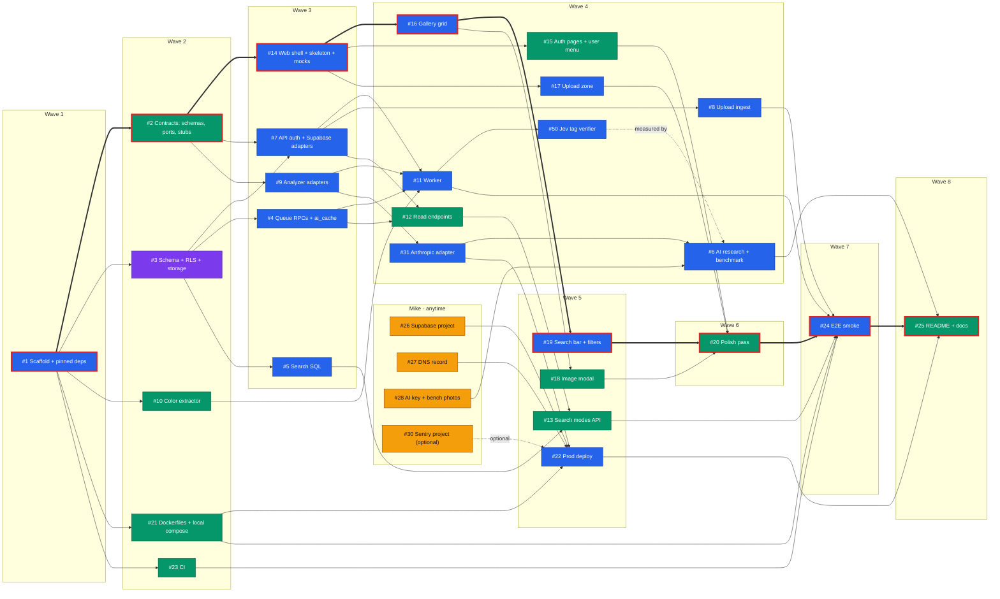

# Critical path and swarm plan

Each box below is a GitHub issue, and the number is the issue number. The **thick arrows** and **red borders** mark the critical path. If anything on it slips, the whole MVP slips.

**Legend:** 🟪 Opus · 🟦 Sonnet · 🟩 Haiku · 🟧 Mike (human). A red border means the ticket is on the critical path.

## Reading the plan

- **The critical path has 8 tickets:** `#1 → #2 → #14 → #16 → #19 → #20 → #24 → #25`. It runs through the frontend, so **#2 (contracts) and #14 (web shell + MSW mocks) are the most important early merges.** After them, the web side never waits on the backend.
- **The near-critical backend chain** is `#1 → #3 → #7 → #12 → #13 → #24`, with one wave of slack. Keep #3 and #7 moving.
- **The human tasks only gate #22 (deploy) and #6 (benchmark).** #30 (Sentry) is optional and blocks nothing. Local development runs on `supabase start` and `FakeAnalyzer`.
- **Waves** are earliest-start groups. At most 7 tickets run in parallel (wave 4).

## How the orchestrator steers the swarm

1. **When is a ticket ready?** When its issue is open, unassigned, and every **Depends on** issue is closed. On the critical path, prefer the ticket with the most dependents.
2. **Launching:** one agent per ticket, each in its own git worktree, using the model named by the issue's `model:*` label. Keep at most 5 agents running at once.
3. **Contracts first:** #2 freezes the Python ports, the domain models and the HTTP schemas. #14 freezes the web stubs and the shared `lib/` API. Changes to either after merge need an orchestrator PR, and the orchestrator re-checks the dependent tickets.
4. **Review and merge:** the orchestrator (Opus) reviews every PR against its acceptance criteria and owned paths, then rebase-merges to keep the history readable. If a PR fails review, it goes back to the same agent with concrete comments. After 2 rounds, the ticket escalates one model tier.
5. **Escalation rule:** a Haiku ticket that fails twice moves to Sonnet, and a Sonnet ticket that fails twice moves to Opus. Record the change on the issue so the model choice stays honest.

## Model choice per ticket

| Model | Used for | Tickets |
|---|---|---|
| **Opus** | Security-critical work where a subtle mistake leaks tenant data | #3 |
| **Sonnet** | Feature work across several files that needs some judgment or tricky library integration | #1, #4, #5, #6, #7, #8, #9, #11, #14, #16, #17, #19, #22, #24, #31, #50 |
| **Haiku** | Fully specified, mechanical work with a small blast radius | #2, #10, #12, #13, #15, #18, #20, #21, #23, #25 |
| **Mike** | Accounts, DNS and secrets, which agents must not handle | #26, #27, #28, #30 (optional) |

Each issue states its own model and rationale. This table is the summary.

## Final status

Written with the README pass ([#25](https://github.com/MHHukiewitz/ai-image-gallery/issues/25)), on 2026-10-20. The site is live at https://gallery.hukiewitz.com, and [README.md](../README.md) describes what it does.

- **Done:** every other ticket on the board is closed. That covers the MVP path (#1 → #25 in the diagram above), the first production fixes (the Storage retries in [#59](https://github.com/MHHukiewitz/ai-image-gallery/issues/59), the decode memory fix in [#67](https://github.com/MHHukiewitz/ai-image-gallery/issues/67), the batch bumps and timeouts in [#76](https://github.com/MHHukiewitz/ai-image-gallery/issues/76)), and the optional and improvement tickets: duplicate bumps ([#60](https://github.com/MHHukiewitz/ai-image-gallery/issues/60)), the per-user upload quota ([#77](https://github.com/MHHukiewitz/ai-image-gallery/issues/77)), semantic similarity and search ([#63](https://github.com/MHHukiewitz/ai-image-gallery/issues/63), [#75](https://github.com/MHHukiewitz/ai-image-gallery/issues/75)), and the Jev verifier ([#50](https://github.com/MHHukiewitz/ai-image-gallery/issues/50)).
- **The next-steps wave (2026-10-21):** the README's next steps became five tickets, run by four sessions in parallel with disjoint owned paths. [#84](https://github.com/MHHukiewitz/ai-image-gallery/issues/84) and [#85](https://github.com/MHHukiewitz/ai-image-gallery/issues/85) shared one Opus session because both edit the upload service. The migrations merged in filename order (0012, 0013, 0014), each one checked live in production before its deploy.
  - [#84](https://github.com/MHHukiewitz/ai-image-gallery/issues/84): the quota counts an append-only `upload_log`, and exemptions match user IDs (Opus).
  - [#85](https://github.com/MHHukiewitz/ai-image-gallery/issues/85): originals are stored without EXIF, XMP or IPTC, and a backfill stripped the 49 older ones that carried metadata, checked pixel for pixel against a backup (Opus).
  - [#86](https://github.com/MHHukiewitz/ai-image-gallery/issues/86): the local compose file lists each container's variables (Haiku).
  - [#87](https://github.com/MHHukiewitz/ai-image-gallery/issues/87): analysis results arrive over Supabase Realtime, with polling as a backstop (Sonnet).
  - [#89](https://github.com/MHHukiewitz/ai-image-gallery/issues/89): the worker runs on a generic jobs table. Its migration kept the old worker working until the deploy (Opus).
- **Closed as not planned:** [#28](https://github.com/MHHukiewitz/ai-image-gallery/issues/28), the Anthropic key. It arrives after the deadline, so production stays on Claude Haiku 5.5 through OpenRouter, as [docs/ai-service-choice.md](ai-service-choice.md) describes. Also [#88](https://github.com/MHHukiewitz/ai-image-gallery/issues/88), email confirmation: the app has no password reset or other email-based feature, so an unconfirmed address grants nothing.
- **Still open:**
  - [#30](https://github.com/MHHukiewitz/ai-image-gallery/issues/30): the Sentry project, optional.
- **Known gaps:**
  1. The upload quota is enforced in the API only. A signed-in client could write rows through PostgREST and files through Storage with its own token, and skip it. A database trigger that counts `upload_log` would close that (README, "Next steps").
  2. The old queue's columns and RPCs are still in the schema, unused, until a later migration drops them.
  3. The MSW mocks don't cover the duplicate-bump path.
